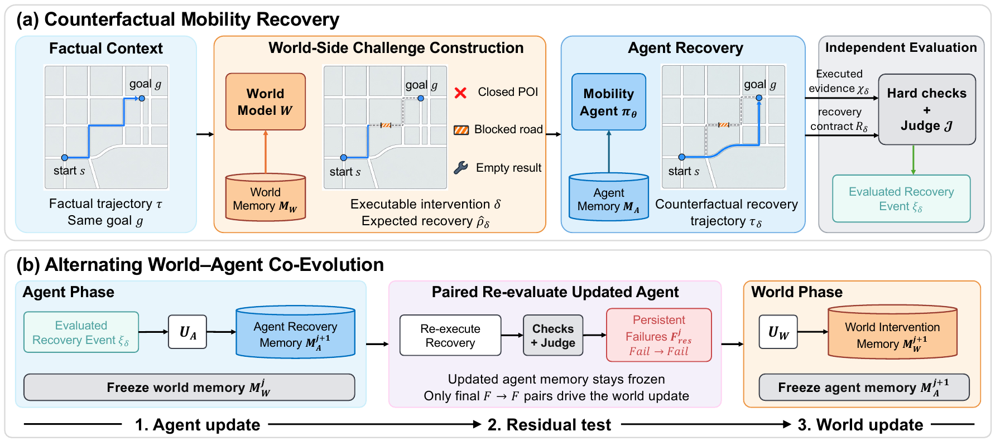

# CCE-Mobility: Counterfactual World-Agent Co-Evolution for Mobility Agents

This repository contains the code implementation of the paper **“CCE-Mobility: Counterfactual World-Agent Co-Evolution for Mobility Agents.”**

[中文说明](README.zh-CN.md)

## Introduction

Mobility agents must recover when a resource or assumption supporting an already-made decision changes. CCE-Mobility constructs **local, executable counterfactual interventions** from factual trajectories while preserving the user's goal and preceding observable history.

The agent learns reusable recovery skills from evaluated failures. Candidate memory changes are curated with paired evidence on the same frozen challenges and contexts. The updated agent is re-evaluated on those exact challenges; **only persistent Fail-to-Fail cases update world memory**, while Success-to-Fail regressions remain agent-side evidence. At deployment, the agent selects at most two relevant skills from observable state. Foundation-model weights are not updated.

<p align="center">
  
</p>

## Setup

**Python 3.12** is the recommended tested environment. The core needs Pydantic; dataset preparation and official TP evaluation use optional dependencies. MobilityBench and SkillOpt upstream runtimes are installed separately rather than forcing incompatible dependencies into the core environment.

```bash
python3.12 -m venv .venv
source .venv/bin/activate
python -m pip install -e '.[dev,data,travelplanner,mobilitybench]'
cp src/cce_mobility/local_secrets.example.py src/cce_mobility/local_secrets.py
mkdir -p configs/local
cp configs/models/openai_compatible.example.json configs/local/models.json
```

### API Keys and Model Services

Fill your own keys in the **gitignored** `src/cce_mobility/local_secrets.py`. In `configs/local/models.json`, explicitly set protocol, endpoint, available model name, and inference options for Agent, WM, and Judge. Agent and WM share a foundation model; Judge is independently configured. Connectivity checks make real, potentially billable calls. Unavailable models fail rather than silently switching.

The default key file has only **two fields**: `CCE_MODEL_API_KEY` for Agent/WM and `CCE_JUDGE_API_KEY` for Judge. Use the credentials issued by the service configured for each role; these names do not require a separate CCE account. For example, Qwen Agent/WM plus a DeepSeek Judge use a Qwen key in the first field and a DeepSeek key in the second. The two values may be identical when all roles use the same account. The config's `api_key_env` selects a key by name from this local file or the environment; exporting environment variables is not required.

Official key documentation: [OpenAI](https://developers.openai.com/api/docs/quickstart), [Qwen](https://help.aliyun.com/zh/model-studio/get-api-key), [DeepSeek](https://api-docs.deepseek.com/en/), [GLM](https://docs.bigmodel.cn/cn/guide/start/quick-start), [Claude](https://platform.claude.com/docs/en/manage-claude/authentication), [Gemini](https://ai.google.dev/gemini-api/docs/api-key).

Chat Completions, Responses, and Anthropic Messages are distinct protocols. See [provider configuration](docs/setup/providers.md) for concrete examples and thinking settings. No credentials or internal model gateway are included.

### Data and Upstream Code

Obtain inputs only from official sources: [TravelPlanner code](https://github.com/OSU-NLP-Group/TravelPlanner) and [data](https://huggingface.co/datasets/osunlp/TravelPlanner); [MobilityBench code](https://github.com/AMAP-ML/MobilityBench) and [data/sandbox](https://huggingface.co/datasets/GD-ML/MobilityBench). Dataset downloads resolve a revision to an immutable commit and reuse the HF cache. Existing local official data can be read using `--source`. Code revisions, split membership, and input hashes are locked in manifests.

Place datasets in `data/`, upstream code in `third_party/`, and generated runs in `outputs/`; none are committed. TP official evaluation also requires its official database. MB requires official sandbox replay files and Planner–Worker–Reporter execution. Details: [TP preparation](docs/reproducibility/travelplanner.md), [MB preparation and continuation](docs/reproducibility/mobilitybench.md), [third-party notices](THIRD_PARTY.md).

## Quick Start

Edit keys and model settings first, then run the stages below from the repository root. Download and extract the official TP database into `third_party/TravelPlanner/database/` before the last command.

```bash
git clone https://github.com/OSU-NLP-Group/TravelPlanner third_party/TravelPlanner
cce prepare-data --benchmark travelplanner --output data/travelplanner
cce prepare-config --benchmark travelplanner \
  --models configs/local/models.json --data-dir data/travelplanner \
  --repo-path third_party/TravelPlanner \
  --output configs/generated/travelplanner.json \
  --output-root outputs/travelplanner --name travelplanner_cce
cce check-models configs/generated/travelplanner.json
cce train configs/generated/travelplanner.json
cce validate configs/generated/travelplanner.json
cce test configs/generated/travelplanner.json
cce evaluate-official configs/generated/travelplanner.json
```

The generated configuration is shared by every stage. Defaults are TP train45, val180, test1000, seed42, and three matched paired cycles. Override `--train-tasks`, `--cycles`, `--max-phase-updates`, `--validation-tasks`, `--test-tasks`, and `--seed` when generating a new experiment. A cycle contains Agent adaptation, same-challenge final re-evaluation, and a residual World update. The archived phase-update cap of 42 is **not 42 complete cycles**; matched mechanism budgets and historical adaptive budgets are documented separately in [training budgets](docs/reproducibility/budgets.md).

Validation writes `outputs/travelplanner/selected_checkpoint.json` with the selection rule, metrics, and memory hashes. Test uses only that validation selection, freezes memory, and saves `test_manifest.json`. Official factual evaluation is written to `outputs/travelplanner/official/`, separately from dynamic recovery.

For MB, use the same seven CLI stages with its dedicated upstream runtime: [complete MB commands](docs/reproducibility/mobilitybench.md). The public flow uses real continuation, not a text-only posthoc substitute.

No-key checks use synthetic inputs and do not measure model capability:

```bash
cce run-config configs/smoke/travelplanner_offline.json
cce run-config configs/smoke/mobilitybench_mock.json
python -m pytest -q
```

For a three-task, one-cycle paid acceptance run, see [acceptance commands](docs/reproducibility/paid-smoke.md). Fresh public runs can reproduce the workflow, but newly generated challenges or currently available model snapshots must not be presented as the paper's original frozen artifacts.

## Results

### TravelPlanner

Main-paper Table 1: 1,000 factual tasks and 1,503 configured counterfactual cases. All columns below are percentages. Recovery is the raw 0-4 mean divided by 4; Poor Recovery uses the strict raw-score threshold < 2. Official TP columns evaluate factual planning, not dynamic recovery.

| Backbone | Method | Recovery | Poor Recovery | CF Pass | TP CS Micro | TP Hard Micro | TP Final |
| --- | --- | ---: | ---: | ---: | ---: | ---: | ---: |
| Qwen3.6-35B-A3B | No Evolution | 61.40 | 31.94 | 37.59 | 73.40 | 7.77 | 1.20 |
| Qwen3.6-35B-A3B | Reflexion | 53.86 | 45.64 | 34.46 | 73.28 | 7.34 | 1.20 |
| Qwen3.6-35B-A3B | Voyager | 55.31 | 43.05 | 35.33 | 73.31 | 7.99 | 0.70 |
| Qwen3.6-35B-A3B | SkillOpt | 72.01 | 21.69 | 37.13 | 73.46 | 5.24 | 0.60 |
| Qwen3.6-35B-A3B | **CCE-Mobility** | 73.12 | 20.90 | 37.79 | 74.48 | 7.86 | 1.00 |
| Qwen3.8-Max | No Evolution | 48.67 | 46.91 | 37.19 | 82.21 | 34.37 | 6.50 |
| Qwen3.8-Max | Reflexion | 50.54 | 44.71 | 38.99 | 81.33 | 32.18 | 5.60 |
| Qwen3.8-Max | Voyager | 62.11 | 30.14 | 36.66 | 81.56 | 31.88 | 5.50 |
| Qwen3.8-Max | SkillOpt | 55.79 | 38.86 | 36.33 | 81.75 | 33.45 | 5.90 |
| Qwen3.8-Max | **CCE-Mobility** | 68.33 | 23.00 | 36.46 | 83.65 | 34.23 | 5.80 |
| GPT-5.6-sol | No Evolution | 65.19 | 27.21 | 2.33 | 60.84 | 0.44 | 0.10 |
| GPT-5.6-sol | **CCE-Mobility** | 70.12 | 22.22 | 2.20 | 70.15 | 20.83 | 2.30 |
| Claude Opus 4.8 | No Evolution | 53.68 | 41.78 | 1.73 | 60.61 | 9.35 | 1.30 |
| Claude Opus 4.8 | **CCE-Mobility** | 56.41 | 34.80 | 1.80 | 71.90 | 8.86 | 1.40 |
| GLM-5.2 | No Evolution | 35.46 | 58.75 | 26.01 | 72.84 | 8.65 | 0.60 |
| GLM-5.2 | **CCE-Mobility** | 60.59 | 32.47 | 28.68 | 72.88 | 9.56 | 1.00 |

### MobilityBench

Main-paper Table 2: the historical heldout500 panel, with 500 factual inputs and 500 counterfactual cases per method. All columns are percentages. This is a fixed development-panel comparison, not an untouched development-independent test set.

| Backbone | Method | Recovery | Poor Recovery | CF Pass | MB FPR | MB TS-R | MB DEC-R |
| --- | --- | ---: | ---: | ---: | ---: | ---: | ---: |
| Qwen3.6-35B-A3B | No Evolution | 74.16 | 5.60 | 98.80 | 56.00 | 60.58 | 76.99 |
| Qwen3.6-35B-A3B | Reflexion | 75.05 | 3.40 | 96.80 | 58.00 | 59.63 | 75.34 |
| Qwen3.6-35B-A3B | Voyager | 74.61 | 8.80 | 99.00 | 56.20 | 60.04 | 76.58 |
| Qwen3.6-35B-A3B | SkillOpt | 84.84 | 2.20 | 99.20 | 57.00 | 61.12 | 75.34 |
| Qwen3.6-35B-A3B | **CCE-Mobility** | 96.75 | 1.40 | 100.00 | 59.60 | 61.01 | 76.16 |
| DeepSeek-V4-Flash-0731 | No Evolution | 68.09 | 12.20 | 99.60 | 45.20 | 45.14 | 71.70 |
| DeepSeek-V4-Flash-0731 | Reflexion | 75.25 | 5.20 | 98.60 | 48.00 | 46.99 | 70.74 |
| DeepSeek-V4-Flash-0731 | Voyager | 69.96 | 4.40 | 98.60 | 45.80 | 46.39 | 69.97 |
| DeepSeek-V4-Flash-0731 | SkillOpt | 77.88 | 1.60 | 99.60 | 49.20 | 47.37 | 70.52 |
| DeepSeek-V4-Flash-0731 | **CCE-Mobility** | 75.66 | 10.20 | 99.60 | 51.20 | 45.72 | 72.59 |

### Co-Evolution Ablation

Main-paper Table 3: TP validation uses 247 challenges from 149 tasks; MB uses a separate fresh-disjoint 500-case continuation panel. Intervals are paired task-cluster bootstrap intervals, not training-seed uncertainty. The MB Full-versus-Agent-only interval crosses zero.

| Panel | Comparator | Comparator Poor (%) | Full CCE Poor (%) | Improved | Regressed | Delta Poor (pp) | 95% CI (pp) |
| --- | --- | ---: | ---: | ---: | ---: | ---: | --- |
| TravelPlanner validation | No Evolution | 21.46 | 14.57 | 20 | 3 | -6.88 | [-10.61, -3.24] |
| TravelPlanner validation | Agent-only | 18.62 | 14.57 | 14 | 4 | -4.05 | [-7.35, -0.83] |
| MobilityBench fresh test | No Evolution | 64.00 | 41.60 | 130 | 18 | -22.40 | [-26.80, -18.20] |
| MobilityBench fresh test | Agent-only | 42.60 | 41.60 | 64 | 59 | -1.00 | [-5.40, 3.40] |

### Memory Curation and SkillOpt Complementarity

These compact supplementary diagnostics use raw Recovery on the 0-4 scale and rates as fractions. The curation panel is validation, not held-out test; complementarity uses Qwen3.6 and the matched TP test1000 panel. They show trade-offs, not uniform or statistically established superiority.

| Variant | Recovery | Low | CF-Final | Unavailable | Total Tokens |
| --- | ---: | ---: | ---: | ---: | ---: |
| Paired curation | 2.9502 | 0.1822 | 0.0769 | 0.0000 | 2,241,210 |
| Without curation | 2.9581 | 0.1862 | 0.0850 | 0.0000 | 2,355,019 |

| Method | Recovery | Low | Unavailable | CF-Final | TP Hard Micro | TP Final |
| --- | ---: | ---: | ---: | ---: | ---: | ---: |
| SkillOpt | 2.8803 | 0.2169 | 0.0279 | 0.3713 | 5.2402 | 0.6000 |
| SkillOpt + CCE-Mobility | 2.9409 | 0.1989 | 0.0070 | 0.3673 | 5.5895 | 0.8000 |

See [metric definitions](docs/metrics.md) and [evaluation protocol](docs/protocol.md) for denominators, failure predicates, and factual/counterfactual boundaries. Values are transcribed from the supplied paper, not recomputed from the example runs.

## Baselines

[SkillOpt](https://github.com/microsoft/SkillOpt) uses its **upstream trainer** through our task adapters. We adapt [Reflexion](https://github.com/noahshinn/reflexion) and [Voyager](https://github.com/MineDojo/Voyager) to mobility planning and recovery. These baselines retain online memory updates and are not reproductions of the original upstream environments.

See [baseline and complementarity commands](docs/baselines.md). Co-evolution and memory-curation ablations use `--variant agent-only` or `--variant without-memory-curation`; the latter still performs final same-challenge re-evaluation and Fail-to-Fail filtering. It does not remove that residual gate.

## Citation / License

Please cite the paper when using this method:

```bibtex
@misc{cce_mobility,
  title = {CCE-Mobility: Counterfactual World-Agent Co-Evolution for Mobility Agents},
  year = {2027}
}
```

Original code is released under the [MIT License](LICENSE). Upstream code and datasets retain their own terms; see [THIRD_PARTY.md](THIRD_PARTY.md).

Repository layout: `src/cce_mobility/` contains method code and workflows, `configs/` contains templates, `scripts/` contains the upstream MobilityBench Shell launcher, and `tools/` contains release auditing tools. Use the `cce` CLI for the main experiment stages and `python -m cce_mobility.workflows.<group>.<module>` for advanced workflows. [Development guide](docs/development.md).
